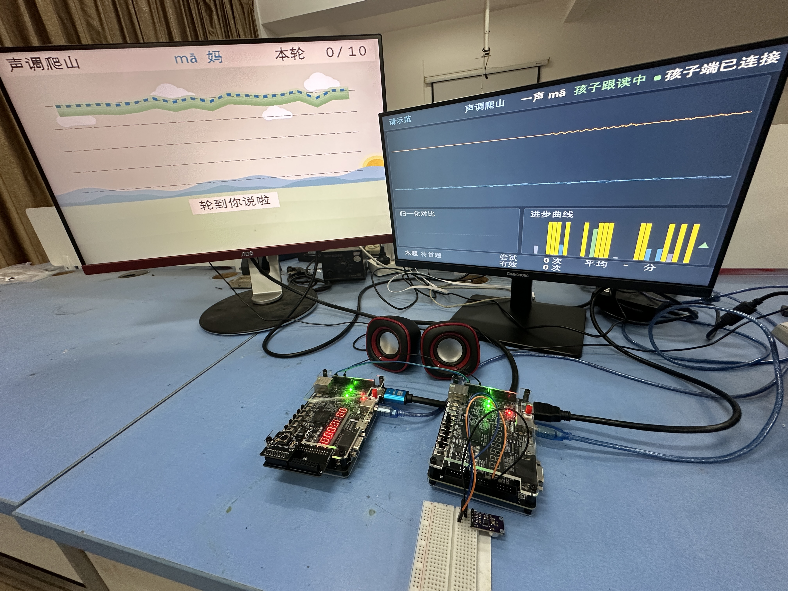
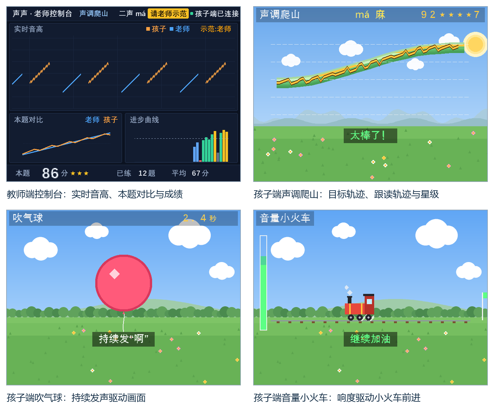
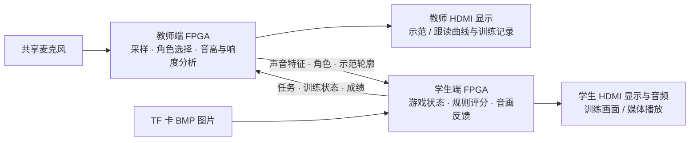

# 声声｜让孩子看见自己的声音

**单麦采声 · 师生双板协同 · 声音驱动的训练交互**

**[观看 / 下载完整实机演示（4分01秒，MP4）](https://github.com/workdc0219-lab/shengsheng-fpga/releases/download/showcase-20261105/shengsheng-demo.mp4)** · [录像说明与片段索引](docs/VIDEO.md)

面向听障儿童的发声练习场景，把声音的高低、强弱和持续时间转成可以观察的画面反馈。教师示范、孩子跟读，两块安路 EG4S20 FPGA 分别呈现声音曲线与训练游戏，让一次练习有目标、有反馈，也有可共同观察的记录。

*实机运行照片：学生端显示声调爬山，教师端显示当前任务、角色与连接状态。*

[五种训练场景](#五种训练场景) · [师生如何配合](#师生如何配合) · [硬件与界面](docs/GALLERY.md) · [构建与接线](docs/BUILD.md)

## 五种训练场景

训练的重点是让孩子知道“这一次声音发生了什么变化”，再据此尝试调整。

| 场景 | 练习内容 | 声音如何改变画面 |
|---|---|---|
| 声调爬山 | 观察并模仿 ma 四声的音高走势 | 跟读音高形成轨迹，与目标走势共同显示，并给出规则评分 |
| 气球 | 持续发出有声的“啊” | 有效发声累计推进气球；较高难度还约束相邻音高变化 |
| 音量小火车 | 维持目标响度范围 | **短按 KEY2 开始**后，响度处于目标窗口时推进；短按 KEY3 回到待机 |
| 看图跟读 | 在图词提示下模仿四个目标词 | māo 猫、yú 鱼、gǒu 狗、tù 兔与教师端目标同步；采用声调轮廓规则反馈 |
| 自由探索 | 建立声音高低、强弱与图形变化的对应 | 音高与响度直接映射到画面，允许自由试声，不作正式评分 |

*RTL 界面渲染示例，使用示例输入和分数，便于查看图层细节；不是实机照片或效果统计。*

## 师生如何配合

1. **选任务**：学生端长按 KEY3 切换训练模式，教师端同步当前任务。
2. **教师示范**：将共享麦克风切到教师角色，采集示范并显示声音曲线。
3. **孩子跟读**：切到孩子角色，沿用同一支麦克风；学生画面随声音特征反馈。
4. **一起观察**：教师查看曲线和训练记录，学生查看轨迹、进度或规则成绩，再进入下一轮。

板间使用双向 UART 传输特征、任务和结果，避免传输整帧图像或原始录音。运行逻辑在 FPGA 中完成，无 MCU、无软核处理器，不依赖 PC 或云端运行。

## 实现要点

| 模块 | 具体实现 | 源码入口 |
|---|---|---|
| 音高分析 | 定点 YIN 差分、累积均值归一化和周期插值；主窗质量较差时按需启用短窗 | [pitch_tracker.v](01_source/teacher_A/board_a/src/pitch_tracker.v)、[教师顶层](01_source/teacher_A/board_a/src/shengsheng_board_a_top.v) |
| 角色与任务协同 | 单麦分角色采集；角色切换后等待新窗口，保留另一角色历史曲线 | [教师顶层](01_source/teacher_A/board_a/src/shengsheng_board_a_top.v) |
| 训练交互 | 五种场景分别组织音高轮廓、持续发声、响度窗口和自由反馈；声调与词卡共用规则评分 | [shengsheng_game.v](01_source/student_B/board_b/src/shengsheng_game.v)、[tone_scorer.v](01_source/student_B/board_b/src/tone_scorer.v) |
| 板间通信 | CRC 校验、会话与题目身份、结果确认/重传和重新握手 | [协议定义](01_source/student_B/spec/protocol_v7.json)、[学生链路协调器](01_source/student_B/common/rtl/v7_link_b.v) |
| 声音与图形同步 | DDS 六谐波哼鸣合成，示范进度驱动轨迹揭示；用于音高示范 | [voice_model_synth.v](01_source/student_B/board_b/src/voice_model_synth.v) |
| 媒体底座 | FAT32 / BMP 解析、SDRAM 缓存、640×480 视频与 48 kHz PCM 输出 | [学生顶层](01_source/student_B/board_b/src/shengsheng_board_b_top.v) |

媒体页支持四幅图片、四条内置旋律，提供淡入淡出、上下推移转场、固定 2×2 均值缩小及居中补黑、五档对比度与参数面板。TF 卡示例位于 [06_media_reference](06_media_reference)。

## 查看工程与复现

| 内容 | 入口 |
|---|---|
| 学生端 / 教师端 RTL 与约束 | [student_B](01_source/student_B/board_b) / [teacher_A](01_source/teacher_A/board_a) |
| 配对位流 | [02_bitstreams](02_bitstreams)，学生 `3BFB9883` / 教师 `C9650B43` |
| 时序与资源报告 | [03_timing](03_timing) |
| 构建步骤、工具版本、完整 SHA256 与接线 | [构建指南](docs/BUILD.md) |
| 已有构建与功能仿真记录 | [BUILD_VALIDATION.json](BUILD_VALIDATION.json) |

在仓库根目录运行 `python BUILD.py check` 可核对交付文件、163 项认证构建输入和两端位流身份。教师端提供完整构建入口；学生端提供封存实现数据库导出与配置比对入口，具体方式见构建指南。

本作品是言语训练辅助原型。规则分描述所选训练任务的完成情况；看图跟读不进行整词语音识别，合成哼鸣不替代真人示范，也不作医学诊断。
