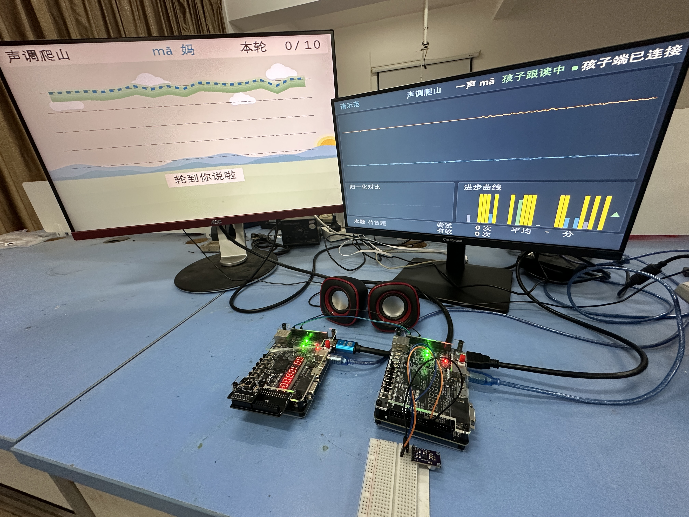
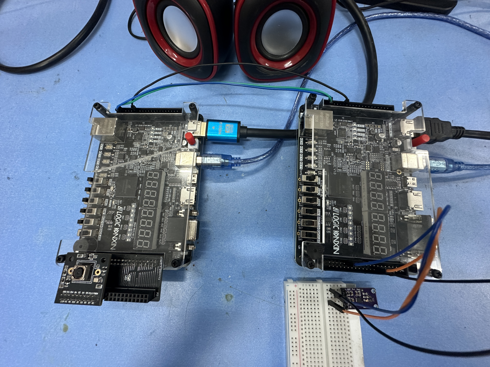
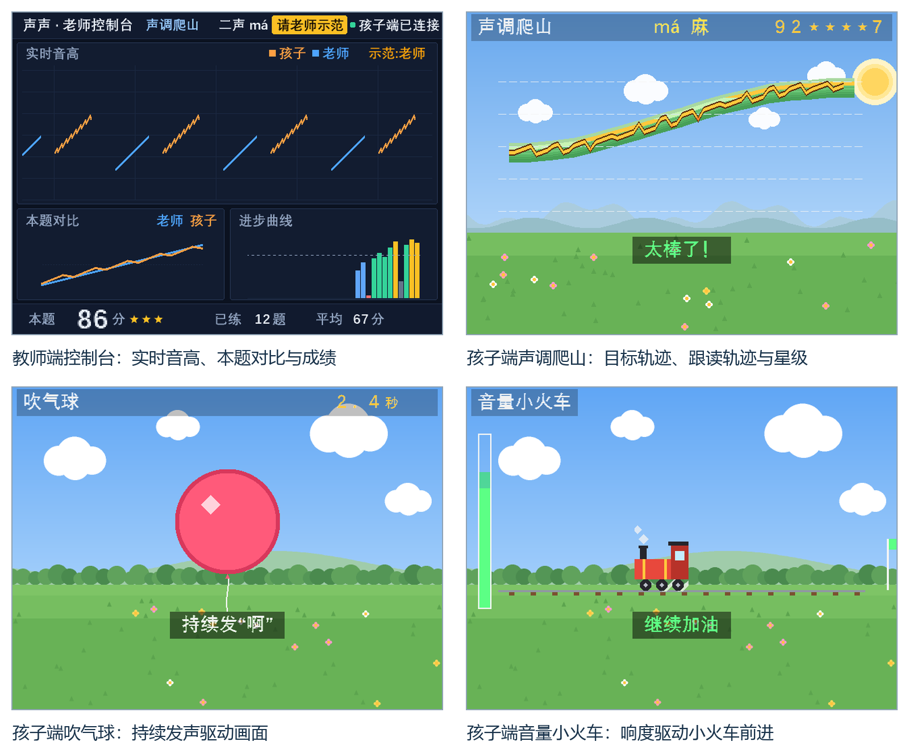

# 硬件与界面

[返回作品首页](../README.md) · [构建与接线](BUILD.md)

## 双屏运行

左侧为学生端的声调爬山画面，右侧为教师端的角色、曲线和任务显示。桌面上的两块 FPGA 分别连接显示器，教师端连接共享麦克风。照片展示实际运行场景。

## 板卡与麦克风连接

接线近照中，右侧板连接面包板上的麦克风模块；两板通过 UART 交叉连接并共地。具体信号和引脚以工程 ADC 约束为准，不能仅凭照片中的线色接线。本图用于展示装配，不代表运行状态。

## 界面细节

上排为教师控制台与学生声调爬山，下排为气球与音量小火车。这是 RTL 界面渲染图，输入、曲线和分数用于展示布局，不作为实测评分或训练效果数据。完整五场景的交互说明见首页。

页面使用的两张实物照片来自本项目拍摄资料，发布副本不含 EXIF。界面渲染与实物照片分别标注。
